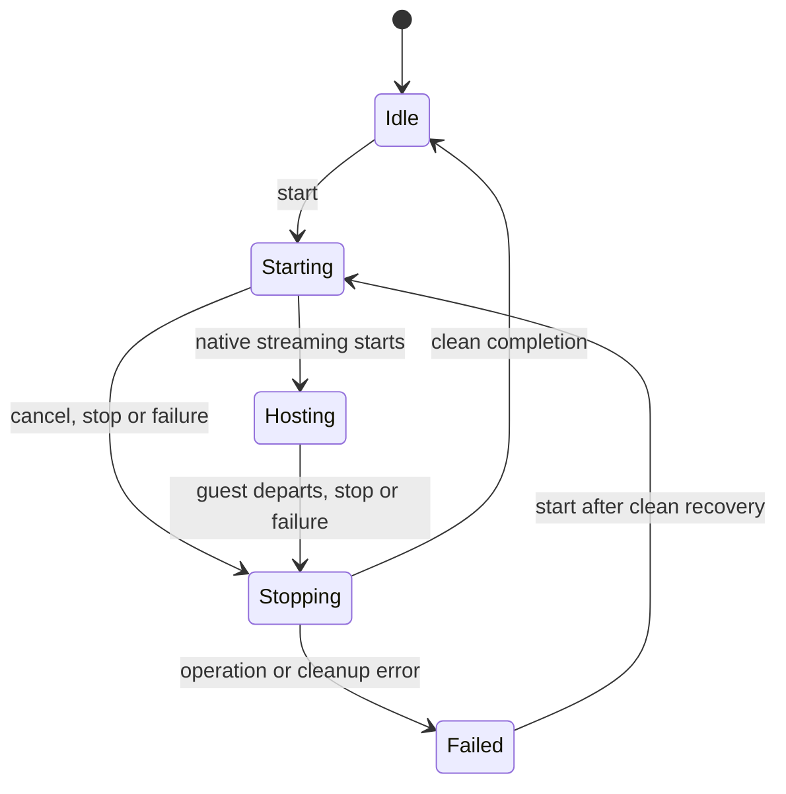

# Lifecycle and ownership

`Host` owns its native worker. The worker owns its SM/account/StreamPlay/parental-control clients, selected-user manager, matchmaking holder/storage, transfer-memory handles, work allocation, connection event, and read-only guest-HID mapping. In separate-display mode it also retains shared ownership of the configured video target. The initialized application SelfController is borrowed and is never closed by the SDK.

Keep one active host per process. A process-wide lease rejects a second concurrent host before native preparation. The native host and guest-input observer are single-session facilities in this implementation; multiple objects are not a way to host several guests or independent sessions.

The optional `CpuImageStreamer` additionally borrows the supported, already-live libounce CPU-console graphics context. Retaining its target does not authorize destruction of that console context. Keep the context and its GPU/synchronization/client resources available, and avoid competing worker-slot-0/VM/range operations, until a joined host reports `canUnload()==true`.

## Public operations

| Operation | Contract |
| --- | --- |
| `start()` | Starts asynchronous preparation; repeated calls while active are ignored. It does not wait for the native UI to finish. |
| `requestStop()` | Requests cooperative worker cancellation and neutralizes published input. It does not join or destroy native resources. |
| `stopAndWait()` | Requests stop and joins the worker. A return does not prove cleanup succeeded; check `canUnload()` afterwards. |
| `canUnload()` | Reports whether ordinary resource teardown/NRO unload is safe. Check after joining; a retained failure keeps it false. |
| `state()` | Reads the worker's state atomically. |
| `controller()` | Returns a copied snapshot under a mutex, with state and freshness checks. |
| `takeError()` | Consumes the pending error string; an empty string means there is no new message. |
| Destructor | Joins the worker. On retained failure the implementation stays pinned; object destruction does not authorize NRO unload. |

Own lifecycle calls from the application's session/UI owner. `requestStop()` may also be used from a connection-termination callback. State, controller and error reads are synchronized. Consume errors on one UI thread. Never join the worker from its log callback.

## States

`Starting` includes service preparation, user selection, native matchmaking and streaming startup. `Hosting` means native streaming has started; it does not guarantee that a controller sample or audible guest output has already arrived. The worker allows a bounded initial connection grace period before treating a zero guest mask as departure.

User cancellation and normal guest departure can return to `Idle` without an error. A failed operation can end in `Failed` even when cleanup succeeds. If cleanup is clean, another start may be attempted. Native failure messages preserve the failing stage and result value; their text is diagnostic output, not a stable machine-readable error enum.

## Cancellation and shutdown

Both user selection and matchmaking use an SDK-owned applet holder. The worker observes stop requests while waiting, requests normal applet exit, and allows five seconds for that exit to complete. It does not forcibly terminate an applet or free backing storage under a running consumer.

The applet wait has a configured deadline. Synchronous OS IPC itself has no timeout supplied by this API, so `stopAndWait()` has no unconditional wall-clock completion guarantee. Keep native services alive until it returns.

Normal shutdown neutralizes input, closes any active applet/session, disables the application's audio-sharing flag when owned, and unmaps guest HID. In separate-display mode, target `retire()` then stops new draws and retires all submitted images while keeping the VI2 layer/display alive. The worker ends the communication context and finalizes StreamPlay. Only after successful finalization does target `close()` release the VI2 layer/display. Owned memory handles are then closed, work memory is freed, and owned service clients are closed.

All three target phases (`open()`, `retire()`, `close()`) run on the worker. A partially failed open still requires retirement and closure; later cleanup phases run only after earlier ones succeed. Retirement failure stops cleanup before native Finalize. Target closure failure occurs after successful Finalize. Either failure retains the remaining resources and quarantines the process. For `NativeGuestDisplay`, `RendererHooks::close` is the renderer-retirement callback called by target `retire()`; the target's later `close()` also performs retirement idempotently before releasing the layer/display.

If a cleanup step fails, remaining allocations, handles and target ownership are retained and the implementation stays pinned. A process-wide restart-required latch blocks later host starts, including starts from a new `Host` object. `canUnload()` remains false. Closing just the PC stream, destroying the host object, constructing another object or returning to hbmenu is not recovery. Close the entire hosting title/process from HOME. There is no public API for clearing that latch.

This retention is deliberate: a failed finalization or retirement does not prove that a native consumer has stopped using the work allocation or image backing. An application must not add its own free/unmap/close fallback for those resources. `RendererHooks::owner` can retain shared renderer context with its target. Keep borrowed dependencies alive too; shared target/context ownership cannot preserve unrelated objects behind raw application pointers or handles.

The research records a crash when Plus unloaded an NRO with retained native initialization. Its exact crash cause was not established. A new NRO load in an existing title process is not a fresh OS process, so it must not be used as a cleanup shortcut. See the [owned-SDK continuation](../../../research/gameshare-probe/notes/SESSION_2026-11-16_OWNED_SDK.md).

## Integrator shutdown order

1. Stop forwarding guest controls and send their release/neutral state.
2. Mark intentional upstream session shutdown to suppress reconnects.
3. Call `requestStop()`, then `stopAndWait()` while all platform dependencies exist.
4. Check `canUnload()`. If false, retain the renderer/backing/platform state, keep the normal lifecycle running, and ask the user to close the entire hosting title through HOME. Do not return to hbmenu.
5. If true, release the application's renderer, audio and applet/window lifecycle, then return/unload normally.

The host never calls application UI code from its worker. UI ownership remains with the application, including safe error presentation and the lifetime of any callback context.
